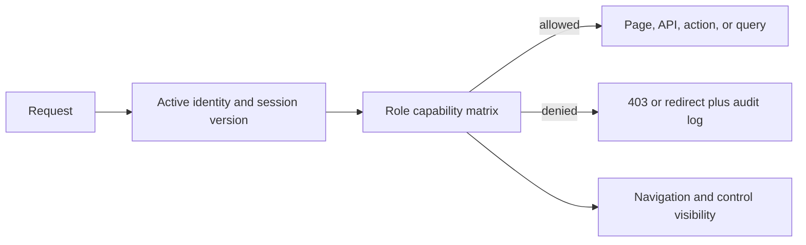

# Admin RBAC policy

`admin/src/lib/rbac.ts` is the authoritative role/capability policy. Pages, APIs, server actions, navigation, UI controls, and query-scope checks must call this module or the server wrappers in `admin/src/lib/server/rbac.ts`. Do not add role-name checks in product features; owner-only identity invariants remain in the identity domain because they protect the ownership model itself.

## Capability matrix

| Role | Capabilities |
| --- | --- |
| owner | all internal capabilities except Venture Lab finance approval and launch approval; those are isolated to the Venture Controller; external partner capability is excluded |
| administrator | internal admin read/manage; portal read/manage/credential reset; all other internal capabilities except internal owner assignment, internal credential reset, Venture Lab finance approval and Venture Lab launch approval; cannot bypass final-owner invariants; external partner capability is excluded |
| venture_controller | operational admin capabilities (excluding owner assignment and internal credential reset), plus existing Venture Lab read/write, finance read/approve, experiment manage, launch approve, integration manage, emergency STOP and audit read; no Venture policy management |
| sales | leads read/write, prospects convert, clients read, projects read, finance read |
| project_manager | portal users read/manage, leads read, prospects convert, clients read/write, projects read/write, Forge read/execute/approve/configure, finance read, audit read |
| developer | clients read, projects read/write, Forge read/execute/approve/configure, audit read, deployments execute, Venture Lab read/audit/integration-manage/emergency-STOP |
| finance | leads read, clients read, projects read, finance read/write, audit read |
| viewer | leads read, clients read, projects read, Forge read, finance read |
| independent_partner | expansion.partner only; own authorised partner records, no internal administration |

Operation Expansion adds `expansion.manage` for owner and administrator only and `expansion.partner` for independent partners only. Operational admin capability inheritance does not grant either capability to Venture Controllers. Founder management and external partner access are separate capabilities.

Identity capabilities are deliberately separate: `admin_users.read`, `admin_users.manage`, `admin_users.credentials.reset`, `admin_users.owner.assign`, `portal_users.read`, `portal_users.manage`, and `portal_users.credentials.reset`. The remaining capabilities are `leads.read`, `leads.write`, `prospects.convert`, `clients.read`, `clients.write`, `projects.read`, `projects.write`, `forge.read`, `forge.execute`, `forge.approve`, `forge.configure`, `finance.read`, `finance.write`, `settings.manage`, `audit.read`, `deployments.execute`, `analytics.read`, `analytics.write`, `claims.read`, `claims.manage`, plus the `venture.*` capability family for Venture Lab read/write, finance request/approval, experiment/launch control, policy/integration management, emergency STOP and audit access.

Internal identities are available at `/users` and `/api/admin-users*`; external client identities are available at `/portal-users` and `/api/portal-users*`. A portal manager cannot reach internal identity data or mutations. Reads and ordinary mutations use distinct capabilities. Credential resets are body-dependent operations and are guarded again inside each API handler; portal reset payloads cannot be combined with email or status mutations. Internal owner assignment, password reset, and MFA invalidation remain owner-only domain invariants.

## Enforcement

Node middleware reloads the persisted user, validates session version/active status, maps the request path and method to a capability, and rejects denied APIs with 403 before the handler runs. Denied pages redirect to the role-appropriate safe landing page: roles with leads access, including Venture Controllers, return to `/command-centre`; delivery-only roles return to `/dashboard`. The PWA starts at `/` to use the same server-side role routing. Sensitive path rules for audit exports, Forge integrations, approvals, deployment, Forge operations health, and analytics retention execute before generic domain rules. Body-dependent actions additionally call `guardApiCapability` inside the handler.

Server helpers:

- `requireCapability`: base server guard;
- `guardPageCapability`: redirecting page guard;
- `guardApiCapability`: API handler guard;
- `guardServerActionCapability`: server-action guard;
- `requireQueryScope`: capability plus database-scope assertion;
- `hasCapability`, `isNavigationVisible`, and `canUseControl`: client-safe policy decisions.

Internal roles retain `global` or `none` query scope. Independent partners receive `partner` scope only for `expansion.partner`; each partner service derives the profile from the active persisted identity and filters every owned record by that profile. The external request allowlist admits `/partner` pages, registered `/api/partner` operations and self logout; unknown pages and every internal surface fail closed for this role. The invitation activation consumer is the sole public partner exception and requires a hashed, expiring, single-use token after founder onboarding confirmations.

Generic identity management cannot create a partner, promote a partner to an internal role, or activate a partner. Emergency disablement and session revocation remain available. Founder-issued invitation credentials are consumed atomically; activation creates no authenticated session and partners sign in through existing Auth.js.

Every denied request emits a redacted structured warning and monitoring message with actor ID, role, capability, method, pathname, and request ID. No request body is included.

## Change control

Any new API route must map to a capability. The RBAC tests enumerate non-auth route files and fail if a route has no GET or POST policy. Changes to roles or capabilities must update the explicit matrix test and receive a security review.
