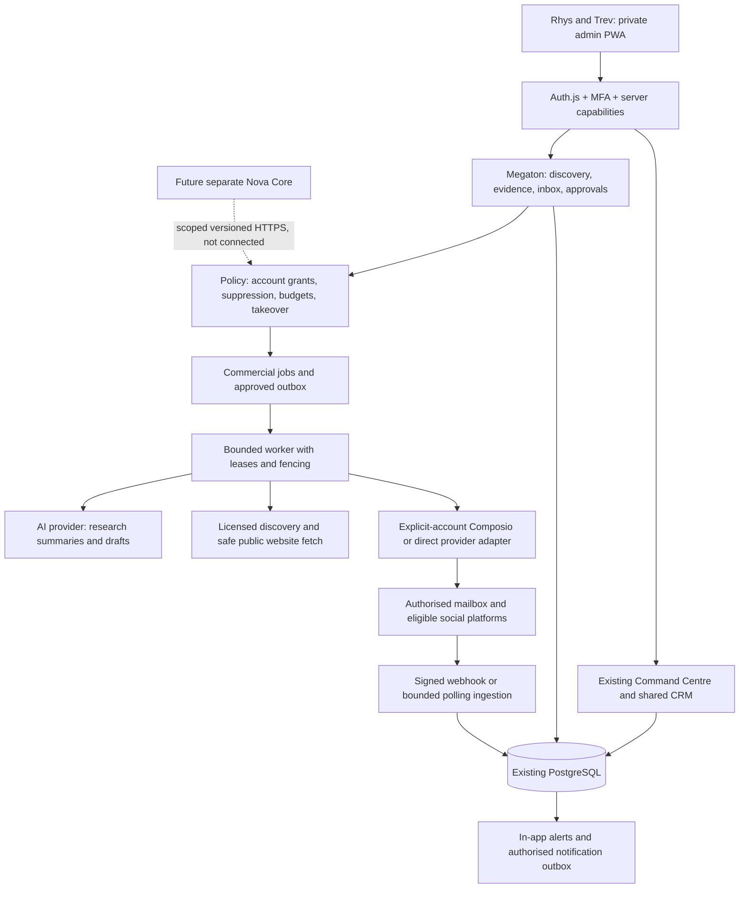
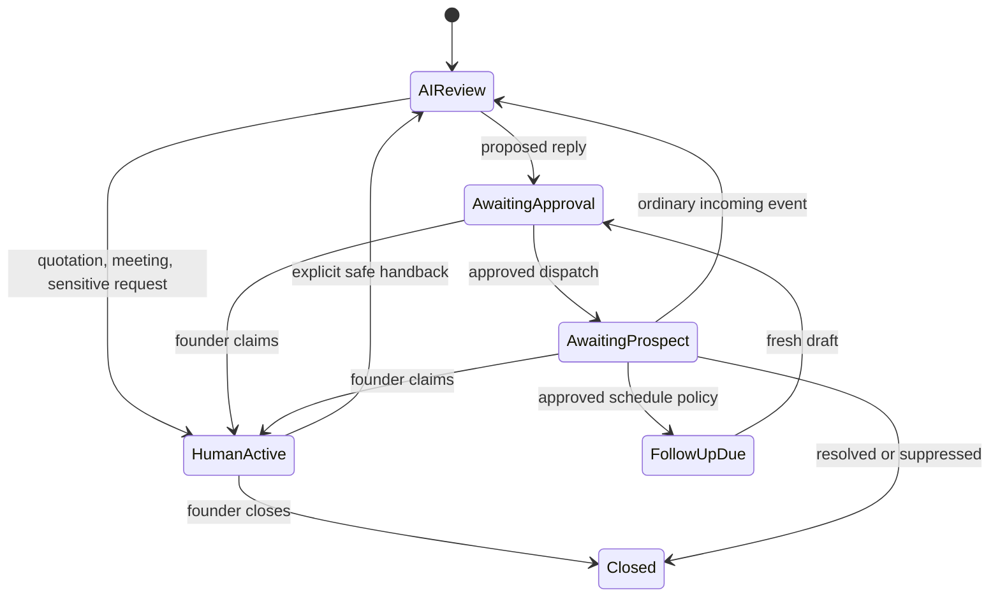

# PROJECT MEGATON: audit and architecture

Prepared 13 October 2026. Status: proposal for review, not an implemented or operational system. Scope follows the supplied master brief: audit and architecture before significant implementation, external connections, spending, sends or deployment.

## A. Current system findings

The existing private admin should remain the product. Do not build a second CRM, authentication stack, database or deployment system.

| Area | Inspected evidence | Decision |
|---|---|---|
| Shared CRM | `admin/src/lib/schema.ts`, `command-centre.ts`, `server/command-centre.ts`: prospects, contacts, ownership, tasks, activities, proposals, contracts, payments, forecasts, settings and audit history | Extend these records; preserve IDs and pipeline stages |
| Revenue | `contractMetrics` counts eligible confirmed recurring contracts within their active dates; commercial payments are separate records | Preserve contract-backed MRR, distinguish receipts and forecasts |
| Deduplication | Normalised company/domain/email checks, advisory transaction locking during lead creation, contact checks and manual duplicate override | Add provider identities and reviewable matching; do not automatically merge businesses by name |
| Suppression | Lead/contact suppression prevents relevant manual activities | Preserve as a deny rule; add channel/account/address-level suppression and legal eligibility |
| Scoring | `lead-scoring.ts` has deterministic factors, confidence and missing-field explanations | Existing heuristic closing probability is not a calibrated prediction. Add a versioned evidence-based model without rewriting past scores |
| Messaging | Email/LinkedIn/WhatsApp activity labels; Resend invoice and portal notifications; portal request messages | These do not constitute a connected external inbox or approved outreach dispatcher |
| Identity | Auth.js, MFA, active-user/session-version checks and capability-based server authorization | Preserve. Operational access never automatically grants access to a founder's personal accounts |
| Trev | Venture Controller now includes operational capabilities while retaining Nova approvals | Preserve the approved authority split; do not change capital authority for Megaton |
| PWA | Private root entry, network-only worker, installation/update components | Preserve private/public isolation. Existing installation support does not prove push notification delivery |
| Forge | Durable leased jobs, retries/dead letters, reservations and provider controls | Reuse queue/budget design principles, not Forge project-bound tables or budget allocations |
| External service boundary | `jarvis-service.ts` exposes scoped read actions with hashed bearer-token verification, persisted identity and session revocation | Useful precedent, not an existing Nova Core connection or approval API |
| Public offers | Managed business email catalog specifies £15/month | Centralize offer definitions while preserving truthful public claims |

The required offer catalog is email £15/month, audit £395, website from £2,000 and Growth Partnership £350/month with the audit included. The brief establishes the inclusion requirement; the audit did not establish a matching existing central inclusion rule. Do not sell an additional audit when the partnership already includes it. Twenty-eight partnerships imply a **target** of £9,800 MRR, not current revenue.

Local source inspected at `144639f5ddccbbed0fc47a11c5cbe3d7f82d1c27`. Read-only endpoint verification confirmed deployed release `281adb6b6dfc1bec044fbe5bc2c2960630506175` at both public and loopback health endpoints, including database health, public PWA assets/login and unauthenticated Forge protection. Deployment evidence from the preceding incident showed PM2/Nginx serving the release; repository Compose policy remains a separate supported topology. No deployment occurred during this audit.

This is a source/configuration audit, not a complete production database catalog, founder-authenticated acceptance test or restore drill. Backup documentation describes encrypted backups and recovery targets; actual off-host coverage, latest successful backup and restore duration remain unverified. Existing CI/test evidence must be refreshed against the eventual implementation SHA.

## B. Proposed architecture

Modules live within `admin/`: discovery/evidence, deterministic scoring, communication adapters, conversations, drafting/approval, policy/dispatcher, commercial jobs/budgets, attribution and operations. UI invokes typed server handlers; models cannot invoke unrestricted provider tools. Use the existing database/migration planner with new admin-owned forward migrations. Do not edit historical migrations or add public admin routes.

### Proposed schema

All new mutable resources carry timestamps, server-derived actor, version and business scope. Foreign keys use existing prospect/contact/admin-user IDs. Provider-specific opaque IDs are not interchangeable with local IDs.

| New table group | Required fields and constraints |
|---|---|
| `prospecting_campaigns`, `discovery_runs` | country GB, town/region/bounds, industry, source, filters, limits, run state, usage reservation, idempotency key |
| `prospect_evidence` | prospect, source URL/provider/reference, independently observed fact, observation time, confidence, expiry, licence/retention classification; interpretation separate from observation |
| `external_identities`, link audit | provider/account/external ID unique; reviewed canonical business link; company number/domain/location evidence; reversible merge history |
| `score_models`, `score_runs`, factors | immutable model version, weights, input evidence IDs, contribution, missingness and confidence; reproducible historical result |
| `communication_connections`, grants | owner, personal/company designation, provider connection reference, permitted actions, explicitly granted readers/operators, consent/revocation and health; encrypted secret references only |
| `conversations`, `messages` | connection + external thread unique, prospect/contact optional, visibility, owner, revision/fence, provider message ID unique per account, direction and source |
| `outreach_drafts`, approvals, outbox | immutable approved content hash, recipient/account/channel, thread revision, expiry, approving actor, single-use consumption; unique send operation key |
| `provider_events` | authenticated account mapping, provider event ID unique per connection, delivery timestamps, processing state; minimal protected payload |
| `commercial_jobs`, attempts | type, bounded payload, lease owner/expiry/fence, retry policy, DLQ, cancellation, correlation and deduplication keys |
| usage reservations and ledger | provider/model/campaign/day/month caps, reserved/spent/unknown costs, integer minor units and actual currency; atomic reservation |
| suppression and notification outbox | address/channel/account/global scope, reason/source/time; notification recipient ACL, deduplication and delivery state |
| campaign touchpoints | prospect/conversation/campaign/source links, event times and attribution model; no second financial ledger |

A domain shared by branches is not sufficient to merge them. Fuzzy names propose matches for human review. Repeated discovery updates provenance on an existing match rather than creating another lead. Legacy suppression remains effective even before backfill.

### API and permissions

Proposed private `/api/megaton/v1` endpoints: campaigns CRUD; discovery start/status/cancel; evidence and score read/recompute; connection authorize/status/revoke; inbox list/thread; draft create/edit; approval grant/revoke; approved dispatch; takeover/handback; usage/health. Use bounded pagination, strict schemas, optimistic versions and idempotency headers on mutations. Webhooks have their own signature-authenticated route, not anonymous mutation authority.

Separate capabilities: discovery run, evidence read, draft create, outreach approve, conversation claim/release, connection manage, usage manage and audit read. Both founders can operate the shared business workspace under existing roles. Personal account content additionally requires a resource grant from its owner; finance visibility and Nova approval authority remain unchanged. Workers use narrowly scoped service identities, not founder passwords. Revocation blocks queued jobs and future reads immediately.

Future Nova Core receives an independently approved, versioned HTTPS capability contract with explicit scopes, expiration/revocation, bounded records and auditable actions. No direct database access, transferred private memory or assumed founder authority. The existing Nova Venture Lab is a different bounded domain and remains unchanged.

### Conversation ownership and sending

Keep workflow status and ownership as separate fields: “assigned Trev/Rhys” is ownership, not a substitute for awaiting approval/prospect status.

Initial mode requires human approval for outbound messages and replies. Approval binds exact account, recipient, content, thread revision and expiry. Editing a draft, receiving a new message or transferring ownership invalidates old approval. Claiming a conversation cancels queued AI sends and increments a fencing version. AI cannot send while human-owned; explicit handback never resurrects old approvals.

The dispatcher rechecks current account grants, suppression, legal eligibility, owner/fence, approval and kill switch immediately before sending. Serialize claims and dispatch transitions per conversation. A provider request already started cannot be recalled: expose in-flight state and reconcile it rather than promising instantaneous cancellation. Record timeout-after-send as UNKNOWN; retry only after provider reconciliation or reliable idempotency, never blindly send again.

Webhook ingestion verifies raw-body signatures and replay bounds, resolves account through stored connection mapping, persists a unique event then acknowledges. Background jobs classify and update threads. Repeated/out-of-order events cannot regress thread revision or trigger duplicate replies. Native-mailbox replies must be reconciled before any further dispatch.

Jobs claim atomically with leases/fences, bounded retries/backoff and DLQ; use per-provider concurrency/rate limits. Reserve spend transactionally before model/provider work. Unknown charges remain reserved until reconciled. Global, campaign and connection kill switches stop new effects; already-started requests are reported. Operations show queue age, worker heartbeat, account failures, uncertain sends and budget remaining with actionable retries, not raw provider payloads.

## C. Integration feasibility

See [the capability matrix](integration-capability-matrix.md). These are documentation-supported possibilities, not live verified accounts. Provider permissions, app review, account eligibility, policy and commercial entitlements remain prerequisites.

Composio should be an optional adapter, not the authorization system. Use current `@composio/core`, explicit user/account selection and pinned toolkit/action schemas. No automatic shared-account or Instant Tools fallback for private communications. Its current TypeScript SDK is ESM-only and requires Node >=22.22.3; local Node is 22.19.0. Confirm production runtime and repository governance before selecting a compatible pinned SDK or approved Node 22 patch update. No dependency changes have been made. [SDK documentation](https://docs.composio.dev/docs/providers), [current SDK migration](https://docs.composio.dev/docs/migration-guide/new-sdk).

Gmail managed triggers can have polling latency; do not promise instant takeover from a polling-only channel. Google restricted-scope verification/security assessment requirements depend on OAuth deployment and server access. Composio does not automatically eliminate the application's responsibilities. [Triggers](https://docs.composio.dev/docs/triggers), [Google verification](https://developers.google.com/identity/protocols/oauth2/production-readiness/restricted-scope-verification).

## D. Build versus buy

Build shared CRM extensions, evidence/scoring, ownership, approval, suppression, outbox, budgets and attribution internally: these determine business authority and must survive provider replacement. Buy or integrate licensed discovery/enrichment and eligible platform transport. Composio can reduce OAuth/tool integration work; direct mailbox adapters may be simpler for one company account. Retain an adapter interface and canonical thread model either way.

Evaluate Hunter/Apollo against a small approved Hucknall/Nottinghamshire sample for coverage, legal reuse rights, source quality, duplicates and cost per usable lead. Neither is established as a suitable local-trades source by this audit. Companies House can validate registered entities, not discover every sole trader or grant marketing permission. Avoid purchasing a full social scheduler or second CRM until there is evidence that it reduces work without bypassing approvals.

Google Places can help locate candidates, but storage/attribution restrictions materially affect a persistent CRM. Place IDs have a storage exception; general listing content does not become freely reusable CRM or AI-training data. Prefer licensed persisted data and independently gathered business-website observations. Confirm permitted use and field-mask billing before adoption. [Places policies](https://developers.google.com/maps/documentation/places/web-service/policies), [billing](https://developers.google.com/maps/documentation/places/web-service/usage-and-billing/).

## E. Exact Phase 1 specification

Deliver one complete acquisition loop: selected UK town/industry → verified candidates → evidence → score → founder-reviewed draft → one authorised company mailbox → inbound event → human takeover → existing pipeline/revenue records.

1. Add additive admin schema and typed services with feature flags, default external effects disabled. Preserve public site, Forge and Venture Lab.
2. Discovery form requires GB and explicit town/industry, source and run cap. Geographical bias is insufficient: independently validate town/postcode/bounds. Quarantine uncertain/conflicting geography. No silent overseas candidates or unlimited crawler.
3. Safely fetch a bounded number of public website pages using existing SSRF/DNS/redirect controls, content/size/time limits and source terms. Store dates and attributable observations; external text is untrusted.
4. Implement provisional 25 ICP / 25 verified digital opportunities / 20 signals / 15 commercial fit / 10 contactability / 5 completeness model. Missing data contributes no invented evidence and is displayed separately. Do not normalize missingness into an apparently high score. Proposed insufficient-evidence threshold: fewer than three independently supported categories or under half of weighted evidence coverage; founders can revise the versioned policy after a pilot. Never call the score a validated closing probability.
5. Central offer catalog and draft templates explain the actual observed opportunity without fabricated traffic, rankings, budgets or revenue. Show offer, source facts, recipient, sending account and approval status together.
6. Implement one mailbox adapter after confirming the actual company provider. Gmail, Microsoft 365 and IMAP/SMTP require different work; current Resend notifications do not prove an inbound mailbox integration. No purchased mailbox or outreach subscription assumed.
7. Implement approvals/outbox, suppression and idempotency; schedule via the application's approved outbox when a provider has no native schedule API. Incoming quotation/meeting requests claim/assign a human immediately; low-confidence classifications also route to review.
8. PWA has Today, Prospects, Inbox, Approvals and Operations views within existing navigation. Use compact summary bars, searchable/filterable lists, readable details, persistent primary actions and a single contextual action menu. Mobile uses stacked cards and thread details, never an eight-column compressed board. Evidence and unknowns remain visible.
9. In-app takeover notifications and existing approved transactional notification transport; push is a separate implementation/consent task if required. Account ownership is visible on each thread and draft.
10. Analytics distinguishes discovered, usable, eligible, approved, provider-accepted, delivered where evidenced, replied, meetings, won, confirmed MRR and received cash. Attribute to campaign/account/source with an explicit model; count unique conversations and filter tests. Track tool/model cost per qualified lead and acquisition, not vanity scores or speculative revenue.

Excluded from this first release: all-platform social publishing, autonomous sends, automatic paid campaigns, new payment execution, Nova Core connection, imported private memories and full replacement of existing CRM/Forge. Unsupported channels remain visibly unavailable, not simulated as connected.

## F. Estimated operating costs

Prices observed 13 October 2026; confirm checkout currency, taxes, entitlements and terms before purchase. No subscription has been activated. Keep original billing currencies rather than inventing a GBP conversion.

Illustrative AI allowance per lead across research summary, one draft and bounded reply classification: 12,000 input + 2,000 output tokens. GPT-4.1 mini at $0.40/$1.60 per million tokens gives $0.008/lead; allow twice that for bounded retries. This is a pricing baseline, not a latest-model recommendation or a measured workload. Evaluate factuality/latency before selecting any model. [Official model pricing](https://developers.openai.com/api/docs/models/gpt-4.1-mini).

| Monthly researched leads | Base AI | AI with 2x allowance | Example integration subscription | Optional data allowance |
|---|---:|---:|---:|---|
| 100 | $0.80 | $1.60 | Composio Pro $29, if chosen | Hunter Starter: €34/month equivalent, €408 annually upfront |
| 500 | $4.00 | $8.00 | $29 | Same Starter allowance, if coverage/credits suffice |
| 1,000 | $8.00 | $16.00 | $29 | Starter at its nominal 2,000 monthly credit equivalent if using two credits/lead; little retry/headroom |
| 5,000 example | $40.00 | $80.00 | $29 plus applicable usage | Hunter Growth: €104/month equivalent, €1,248 annually upfront; confirm credits and API needs |

Composio Hobby has a zero-price capped allowance; Pro adds spend controls and a self-serve DPA option. Own-app allowances are 100k tool calls/50k delivered triggers monthly, with managed-app sublimits 20k/10k. Pro overages differ by auth mode; Instant/provider charges and optional shared/proxy execution add-ons are separate. At an assumed six calls and five delivered events per lead, 1,000 leads fits those managed limits; 5,000 does not. Privacy/contract requirements may justify Pro even below usage limits. Its credit does not pay our separately billed AI provider. [Composio pricing](https://composio.dev/pricing).

Hunter's fetched pricing page shows annual billing; do not present €34 as a cancellable monthly plan. Starter includes 24,000 annual credits; Growth 120,000. Actual credit consumption and monthly purchase price require confirmation. This is an optional enrichment budget, not verified town-discovery coverage. [Hunter pricing](https://hunter.io/pricing/).

Illustrative 1,000-lead incremental allowance is therefore $45 plus €34/month equivalent when selecting those two annual/paid options, excluding VAT, FX and the exclusions below. A manually sourced pilot without Composio/Hunter can have lower vendor cost, but that is not equivalent automated discovery.

Not priced by this audit: existing VPS/mailbox subscriptions, licensed town discovery, Google field-mask requests, X access, security assessment, monitoring/off-host backup, legal review and implementation labour. Do not call the above a complete operating total. Human review dominates: at three minutes/lead, 100/500/1,000/5,000 leads require 5/25/50/250 hours before follow-ups. Prefer smaller qualified batches. Proposed pilot spend caps must be approved in each billing currency before live use; alert at 50/80/100%, reserve before calls and stop at the cap.

## G. Security and compliance

Apply UK GDPR/PECR channel and subscriber rules before dispatch. Corporate B2B email differs from sole traders and some partnerships. Public email availability is not consent, and legitimate interests do not override PECR consent requirements. Treat unknown legal form as requiring individual-subscriber handling until checked. Record lawful basis, transparency notice, source, objections and suppression. Guidance is under review following legislative changes; review against current ICO guidance before a pilot. [ICO B2B marketing guidance](https://ico.org.uk/for-organisations/direct-marketing-and-privacy-and-electronic-communications/business-to-business-marketing/).

Account owners authorize their own connections and visibility. Enforce grants on search, exports, notifications, model payloads and service reads, not just UI routes. Use dedicated OAuth encryption key material or approved provider vault references; never reuse analytics keys, log tokens or put credentials in browser code. Review processors, subprocessors, international transfers, retention and platform terms before customer/personal data leaves the application. Retention periods are a policy decision, not established in this audit; implement expiry/deletion and minimised suppression retention with deletion-safe identifiers.

Treat retrieved pages/messages as untrusted evidence. No instruction in them can grant tools, change policy, approve a send or retrieve unrelated private data. Limit model context to the authorised thread and selected evidence. Structured outputs validate into proposals; deterministic policy decides effects. Redact protected payloads from telemetry and DLQ summaries. Disable tracking pixels by default pending a distinct compliance decision.

## H. Risks and unresolved facts

The principal unknowns are the actual company mailbox/provider, required OAuth/app permissions, eligible account types, local discovery coverage/licensing, personal-account visibility preferences, approved spend limits, platform-review turnaround, production runtime compatibility and proven restore readiness. SDK package version and live action schemas must be pinned during implementation, not guessed from examples. Threads connector and inbox capabilities were not established by accessible Composio documentation.

No external accounts or discovery endpoints were exercised. No messages were sent, charges incurred, database migrations applied or production state modified in this audit. Production health/assets are verified; authenticated founder flows, personal-account isolation, provider receipts and physical PWA installation are not re-proven by those checks. Social launch dates cannot be promised before app review and account eligibility are confirmed.

## I. Ordered execution and acceptance

| Order | Work and dependency | Acceptance evidence |
|---|---|---|
| 1 | Approve bounded Phase 1; confirm company mailbox and spend/visibility policy | Written scope; no implied provider/spend/deployment authorization |
| 2 | Capture baseline, schemas and recovery evidence; resolve SDK/runtime selection | Exact-SHA app/repo gates and isolated restore evidence; compatible locked dependencies |
| 3 | Forward migrations, grants, evidence, scoring and feature flags | Shared migration planner/gates; cross-founder business access; personal account denial; reproducible unknown-data scores |
| 4 | Licensed discovery and website evidence pilot, after source authorization | Real selected-town sample; relevant source citations; repeated job creates no duplicate; foreign/unknown geography quarantined |
| 5 | Draft/approval, suppression, budgets, outbox and ownership fencing | Tests execute production services: edited/expired approvals denied, replay/duplicate send denied, suppressed recipient denied, concurrent takeover wins before dispatch; UNKNOWN send reconciled |
| 6 | Authorised mailbox adapter and inbound ingestion | Controlled real send/receipt/reply with provider IDs; forged/replayed events rejected; no simulated integration reported live |
| 7 | Inbox/mobile operations, attribution and safe handback | Both founder sessions tested; quotation/meeting takeover; no AI send under human ownership; handback invalidates prior approval; mobile no overflow/inaccessible actions |
| 8 | Release gates and recoverable pilot, only after deployment approval | Admin/web lint, tsc and builds; focused/unit/integration/E2E plus relevant root policy gates; rollback/restore drill; no public/Forge/Nova regression |

The first operational release must satisfy all twenty acceptance items in the supplied brief, including two real founder accounts, one authorised live channel, actual inbound handling, takeover, mobile PWA, suppression/send logs, source-backed local discovery, rollback and clear incomplete features. A fixture-only foundation is an intermediate milestone, not that release. Record test source, SHA, environment, actor/account and provider receipt separately from assumptions. Subsequent phases add individually proven social adapters, publishing and reporting; Nova Core contract validation remains disconnected until separately authorised.

Phase 1 implementation scope was subsequently approved by the owner, with the company Mailcow server selected and credentials left for the owner to wire later. See [Mailcow setup and implementation boundaries](mailcow-setup.md). Provider connections, paid services, real sends and deployment still require their corresponding explicit authorization.
