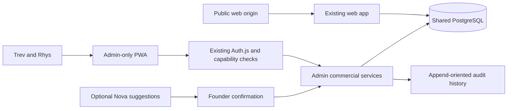

# ScaleSmiths Command Centre inspection and build plan

Inspection date: 11 October 2026. This document records source inspection and a proposed implementation contract. It does not certify production, live accounts, backups, or commercial balances.

## Existing system and reuse

| Area | Existing source | Decision |
| --- | --- | --- |
| Applications | Root, `web/package.json`, `admin/package.json` | Keep two separate Next.js 15.5.25 apps; Node 22 and npm 10.9.2; no new app or CRM. |
| Public routes | `web/src/app` | Preserve homepage, service/location pages, Work, Insights, contact/quote endpoints, robots, and client portal. No public PWA registration or styling changes. |
| Private origin | `docker-compose.yml`, topology policy | Use `https://admin.scalesmiths.co.uk`; public-domain `/admin` is not the canonical entry point. |
| Identity | `admin/auth.ts`, `auth.config.ts`, `src/lib/server/admin-users.ts` | Reuse database-backed credentials, bcrypt, TOTP/recovery codes, active state and session-version revocation. No public registration. |
| Authorization | `admin/src/middleware.ts`, `src/lib/rbac.ts`, `authorization-policy.ts` | Reuse capability mapping and default-deny unmapped APIs. Add handler/service authorization for new and affected commercial mutations. |
| Pipeline | `admin/src/components/ProspectPipeline.tsx`, `src/lib/prospects.ts`, prospect APIs | Extend existing prospects, outreach and proposals; retain existing IDs and conversion links. |
| Client delivery | `src/lib/schema.ts`, prospect conversion service, project APIs | Preserve clients, project/onboarding workflows, service catalogue assignments and portal relationships. |
| Finance | Invoice APIs, `src/lib/server/invoices.ts`, finance components | Reuse catalogue, integer amounts, immutable issued documents, invoice audit and delivery infrastructure. |
| UI | `src/components/admin-shell`, `src/app/globals.css` | Extend existing responsive shell and Lucide/Recharts components with charcoal, gold and silver styling. Preserve Forge and website administration navigation. |
| Jobs/notifications | `src/instrumentation.ts`, Forge worker, Resend modules | Keep existing durable infrastructure. Commercial reminders require a dedicated bounded workflow; a Forge job is not a sales activity. |
| Operations | Compose/Nginx, CI, monitoring modules, `docs/operations/backup-and-restore.md` | Reuse migration planner, encrypted backup/restore framework, request IDs, Sentry and release runbooks. Deployment status must be checked independently. |
| PWA | Admin layout/public assets | No admin manifest or registered service worker found in the inspected app surface. Build admin-only installation. |

## Important findings

1. Activity attribution is client supplied: `parseOutreachActivityPayload` accepts `createdBy` and the activities POST persists it. Authentication in middleware does not make that field trustworthy. Replace with server-derived user UUID; preserve legacy text separately without inventing a historical identity.
2. Prospect PATCH performs read then update by ID without a version predicate. Add optimistic concurrency, return 409 on stale edits, and show a reload/compare flow. Activity insertion and dependent prospect/task changes must commit together.
3. Prospect ownership, multiple contacts, joint collaboration and complete commercial change history are absent from the inspected prospect schema. `updatedAt` alone is not an audit trail. Outreach/proposals currently cascade on prospect deletion; archive commercial records and protect durable history.
4. Existing dashboard MRR derives from `clients.mrr`. This is stored data, but not sufficient evidence of an active signed contract. Existing service assignments reference catalogue items without recurring contract amounts or effective dates. Reconcile units and evidence before changing revenue semantics; never treat prospect conversion or an accepted proposal as proof of a signed retainer.
5. Current pipeline has nine established stages. Extend/map them through forward migrations and retain legacy transitions; do not replace enums or silently relabel closed history.
6. Existing invoice schema requires `total = subtotal`; VAT capability must be assessed and extended before claiming VAT-ready accounting. No payment-event ledger was identified in the inspected invoice schema.
7. Middleware sets private no-store headers and verifies persisted sessions. PWA assets need narrowly defined public access exceptions; never exempt arbitrary static extensions or private APIs. Installation must not bypass authentication.

These are source findings, not evidence of an exploited vulnerability or a complete security audit.

## Target architecture

Use admin-origin manifest scope `/`, start URL `/command-centre`, stable manifest ID, standalone display, dedicated 192/512 icons and Apple touch icon. The separate origin isolates it from public service workers. A minimal worker provides installation lifecycle with network-only handling and no Cache Storage for documents, APIs, authentication, customer or finance data. Check updates on launch/visibility; prompt before activation if a form is dirty, reload after activation, and retain server compatibility during rollout. Test iOS home-screen behavior on a real device; desktop Chromium testing does not certify it.

All private data stays online. Founder dashboards derive their actor from the session and their filters from persisted ownership; ownership must never reduce the other founder's authorized business visibility. Equal commercial permissions must not accidentally grant Venture Lab protected-capital authority.

## Proposed data extensions

All commercial additions belong to admin migration history. Names below are proposals to finalize against live schema and existing constraints, not generated migrations.

- Extend `prospects` with primary owner UUID, joint flag/collaborator relationship, next-action responsibility, normalized domain/name, confidence, expected close date and version. Index identifiers for duplicate suggestions; allow reviewed overrides rather than globally rejecting similarly named companies.
- Add prospect contacts linked to the existing prospect, with primary/decision-maker markers, verified source and suppression/opt-out fields. Retain legacy contact fields during migration and reconcile duplicates explicitly.
- Extend `outreach_activities` with server actor UUID, optional contact reference, occurrence time, structured outcome, next action, AI-assisted/source metadata and idempotency key. Preserve creation time and legacy attribution.
- Add commercial tasks linked to prospect/contact and assigned admin user, with due time, priority, status, completion metadata, version and optional recurrence. Do not reuse Forge tasks as commercial records.
- Add append-oriented commercial audit entries with transaction-bound before/after values, server actor/time and redaction. No generic update/delete API; confirm database grants enforce the intended retention boundary.
- Add configurable company targets, explicitly agreed individual targets, commercial prices, baseline MRR target of 980000 pence and retained-client target of 28. Individual targets remain unset until agreed, not automatically split.
- Add evidence-backed client contracts with recurring amount in pence, category, status, dates, provenance and version; append-oriented payment allocations/corrections with unique external reference or request key; separate variable-revenue forecasts and realized earnings. Integrate existing invoices rather than duplicating billing.

Legacy amounts require explicit unit reconciliation before backfill. New MRR counts only qualifying active confirmed contracts, counts distinct clients, and excludes forecasts/proposals/variable profit share. Collected income comes from payment events and allocations, never a sum of payments plus invoice totals. Preserve original amounts and record corrections.

## Phases and acceptance gates

| Phase | Deliverable | Required evidence |
| --- | --- | --- |
| 0 | Inventory, founder/account and financial reconciliation, backup/rollback readiness | Read-only database inspection; current account roles/MFA; isolated restore evidence; baseline policy/security tests. |
| 1 | Admin installation, authenticated founder context, responsive shell | Manifest/worker isolation tests, unauthorized API tests, desktop/mobile browser checks; real Android/iPhone installation evidence before certification. |
| 2 | Owned/shared prospects, contacts, quick logging, tasks, audit, weekly targets | Two independent sessions share records; spoofed actor rejected/ignored; stale edit rejected; duplicate warning; activity/task transaction and refresh persistence; London DST/week tests. |
| 3 | Contracts, payments, revenue, 28 Club, conversion charts and CSV | Proposed/lost deals excluded; variable income separated; duplicate payment rejected; partial payments/corrections; distinct retained-client counts; spreadsheet formula-safe exports. |
| 4 | Briefings, scoring, confirmed natural-language suggestions, optional achievements | Core works with AI disabled; no automatic sends/financial changes; ambiguous contacts require selection; London relative dates displayed for confirmation. |

Run focused production-boundary Vitest tests while iterating, then affected app lint, `npm exec tsc -- --noEmit`, build and Playwright. Run migration history/consistency/order, authorization, environment, dependency and topology checks for affected areas, plus PostgreSQL-backed integration tests for transactions and concurrency. Record baseline failures separately. Do not present fixture tests as production evidence.

## Integration and founder decisions

No new paid service is needed for the core. Reuse existing PostgreSQL, Auth.js, catalogue/invoice infrastructure, Resend where authorized, Lucide and Recharts. Gmail/Calendar/push and paid AI remain optional; document exact scopes, token handling, suppression checks and failure behavior before enabling. Opening WhatsApp is only a launch action and requires explicit confirmation before recording a completed message.

Founder decisions: identify existing Trev/Rhys accounts and agree equal commercial capabilities; agree individual weekly targets; confirm existing-stage mapping; verify contract/payment evidence and VAT treatment; define notification channels and opt-out policy. Do not request passwords or provider credentials in chat.

Treat the supplied Confirm-a-Kill amounts and Precision Finish profit share as founder-reported reconciliation inputs. Verify against records before importing; Precision's approximately GBP 500 expected for October 2026 remains a forecast, never MRR. Foot Works, Glow Tanning, Spartacus Spas and Easy-Bathe remain unclassified until verified.

## Deployment and rollback

Work on a development branch. Do not change public web assets, routes, dependencies or service-worker registration. Before production: record exact SHA, validate encrypted backup bundle and isolated restore, reconcile existing financial/identity records, rehearse shared migration planner on a staging clone, complete CODEOWNER review, and obtain deployment authorization.

Use additive migrations and dual-compatible reads while rolling out; never edit checksum-locked history. Roll back application images to the recorded compatible release; retain additive columns and history. Do not drop tables or reverse ledger corrections during rollback. A destructive schema restore is a separate approved recovery action. Removing PWA installation support must unregister only this app's worker and retain private data solely on the server.

## Inspection limits

The initial worktree was clean on `feat/jarvis-read-service`; this assessment uses `feat/command-centre-inspection`. Local Node is 22.19.0. Root `.env` contains a local-development `DATABASE_URL`, but no configured `ADMIN_DATABASE_URL` or `MIGRATION_DATABASE_URL`; values were not printed. After installing admin dependencies, a read-only PostgreSQL connection failed with `ENOTFOUND` (configured hostname could not resolve). No database records were read or changed. Account existence, current record counts and balances remain unverified. Production hosting, backup schedule, restore success and physical-device installation are unverified.

At the initial checkpoint, implementation was deferred until database access could be inspected. The later implementation authorization and isolated development work are recorded below. Production still requires a reachable staging clone, least-privilege database configuration, real identity/financial reconciliation, backup/restore evidence and release approval. Configure credentials locally, never paste them into chat.

## Initial inspection verification

- `check:migration-history`: passed (52 historical and 34 forward migrations locked).
- `check:documentation-links`: passed.
- `git diff --check`: passed; only this new documentation file is changed.
- `check:production-topology`: interrupted after remaining pending for several minutes; no pass claimed.
- Admin `npm ci --ignore-scripts`: interrupted while pending; enough packages were available to perform the failed read-only database connection, but installation is not certified complete. Rerun `npm ci` before application gates.
- App lint/typecheck/build, database integration, browser acceptance, production backup/restore and device installation: not run. No application implementation or deployment is claimed.

## Implementation status

The subsequent instruction to implement authorized development against an isolated local PostgreSQL database despite the unavailable configured database. The preceding inspection limits describe that earlier checkpoint, not the current code. No live records, existing account roles, production migrations or public-web files were changed.

Implemented inside the existing admin application:

- `/command-centre` workspace: Today briefing, shared pipeline, contacts, activities, assigned tasks, revenue, weekly scoreboard, reports and configuration; existing admin navigation and Forge remain available.
- Forward admin migrations `0064_command_centre` and `0065_command_centre_sources_and_versions`; root shared planner and checksums updated. Existing outreach history is reused, not replaced. New tables are `commercial_contacts`, `commercial_tasks`, `commercial_contracts`, `commercial_payments`, `commercial_forecasts`, `commercial_settings` and `commercial_audit`.
- Session-derived attribution, capability-specific mutation checks, same-origin mutation checks, durable rate limiting, idempotent activity entry, row-locked optimistic versions, reviewed duplicate overrides and contact suppression.
- Contract-backed active recurring revenue and distinct retained clients; append-only payments with exact compensating reversals; existing-invoice allocations; separate performance forecasts; formula-safe CSV. Legacy client MRR and founder-reported amounts are not silently backfilled as verified revenue.
- London-local follow-up dates and recurring tasks; explicit-confirmation natural-language suggestions and local conversation-preparation drafts. No live AI, Gmail, Calendar, push subscription or automatic message sending was enabled.
- Private-origin manifest, raster app icons, network-only worker, install/update prompts and offline status. No customer, authentication or financial payloads are stored in Cache Storage.
- Founder email bindings supplied by the user: Rhys `admin@scalesmiths.co.uk`, Trev `trev@scalesmiths.co.uk`. Defaults are one weekly connection and a stretch of two, combined two and four. The user defines a connection as a new two-way conversation with a business decision-maker; the activity logger requires explicit confirmation and a decision-maker contact, and the scoreboard counts each contact once under the first recorded actor. This is not a retainer target. Existing explicit saved targets take precedence. No roles, credentials or Venture Lab authority are changed.

Verification uses only `ss_command_centre_test`, synthetic fixture identities and fixture financial evidence. Desktop/mobile browser verification is executable via `admin/scripts/verify-command-centre-browser.mjs`; its safety check refuses other database names and non-local origins. Never run this fixture-account script against production.

Outstanding release requirements: inspect the real founder accounts and capabilities without expanding capital authority, reconcile contracts/payments and VAT requirements, verify production backup/restore, stage the canonical shared migration plan, obtain protected-area review, verify public enquiry/SEO workflows, and test Android/iPhone installation and updates on real devices. Optional external integrations remain deliberately disabled. This is not a production release certification.

For application rollback, retain the additive migrations and append-only history and restore the previous compatible admin image. Do not edit or remove applied migrations or delete compensating financial entries.

## Changed-file inventory

- Migration ownership: `admin/drizzle/0064_command_centre.sql`, `0065_command_centre_sources_and_versions.sql`, `meta/_journal.json`; root `scripts/migration-checksums.json` and `scripts/shared-migration-plan.json`.
- Shared commercial models and validation: `admin/src/lib/schema.ts`, `prospects.ts`, `lead-scoring.ts`, `command-centre.ts`, `commercial-intelligence.ts` and `server/command-centre.ts`.
- Existing security/navigation integration: `admin/src/lib/authorization-policy.ts`, `rbac.ts`, `admin/src/middleware.ts`, `admin/src/components/admin-shell/AdminShell.tsx`, `ProspectPipeline.tsx`, and app `layout.tsx`, `page.tsx`, `login/page.tsx`.
- Workspace and PWA: protected `command-centre/page.tsx`, `api/command-centre/route.ts`, `manifest.ts`, `app-icon/[size]/route.tsx`, `admin/public/command-centre-sw.js`, and the five files under `admin/src/components/command-centre/`.
- Existing pipeline boundaries: `admin/src/app/api/prospects/route.ts`, `[id]/route.ts` and `[id]/activities/route.ts`.
- Verification: `admin/src/lib/command-centre.test.ts`, `admin/test/integration/command-centre.integration.test.ts`, `admin/scripts/verify-command-centre-browser.mjs` and this operations document.

## Release checklist

- Apply migrations only through root `npm run db:migrate`; committed forward migrations are immutable. Verify database privileges using the separately configured provisioning connection before any provisioning change. Never substitute a runtime URL for `POSTGRES_PROVISIONING_DATABASE_URL`.
- For every PWA release, bump the worker's `VERSION` so its bytes change and the install/update lifecycle offers activation. Keep the server backward compatible with the preceding client during rollout; a worker update alone does not certify client/server compatibility.
- Preserve existing founder identities and MFA. Inspect their actual commercial capabilities; do not promote an account to owner merely to obtain sales access, and do not alter Venture Lab protected-capital authority.
- Reconcile old invoices, client MRR and founder-reported earnings into evidence-backed contracts/payments before expecting the new financial dashboard to match historical reported totals. VAT capability remains the existing invoice system's limitation, not a newly certified accounting feature.
- Repeat protected-area review, staging restore, public-site enquiry/SEO checks and real-device installation/update checks before production deployment. No production deploy was performed by this implementation.

## Final local verification

As of 11 October 2026, using Node 22 and the isolated synthetic database:

- Focused unit verification: seven files, 122 tests passed, including commercial calculations, connection counting, CSV safety and existing authorization boundaries.
- PostgreSQL integration verification: five tests passed, including optimistic conflicts, transaction-bound attribution, decision-maker confirmation and financial ledger controls.
- Admin lint, typecheck and Next.js build passed. Build verification is not browser acceptance or release certification.
- The root shared migration runner applied all 88 migrations to the fixture database. Migration history, consistency and order checks passed.
- Environment hygiene, dependency governance, architecture documentation, production topology and documentation-link checks passed. Public `web/` files and governed dependency versions were unchanged.
- Docker Desktop was restarted with explicit user approval and PostgreSQL recovered. This is not evidence of a production backup restore.
- Browser acceptance remains incomplete. A development-browser attempt authenticated a fixture user, but the development server restarted under memory pressure. Starting the built localhost-only preview was subsequently blocked by tool policy, including after explicit user approval. No successful desktop/mobile screenshot, two-user browser acceptance or physical PWA installation is claimed.

The implementation is ready for the remaining local browser verification and protected-area review, not certified for production deployment. Optional live-provider integrations and live-data reconciliation remain outstanding.
